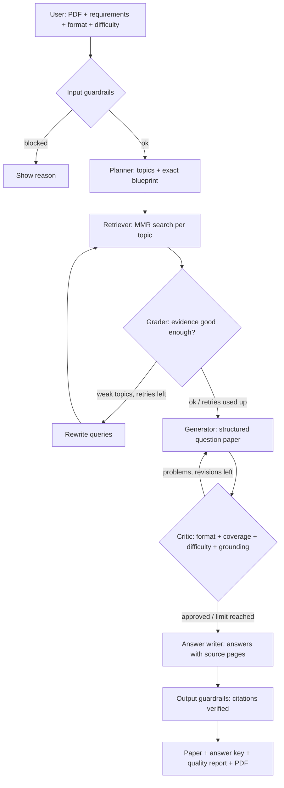

# 📄 AI Question Paper Generator: Agentic RAG with LangGraph

Upload any study PDF, describe the exam you want, and get a complete **question paper and answer key**. Before you see anything, an AI agent plans the paper, checks its own evidence, critiques and revises its draft, and verifies every answer against the source pages.

**Live app:** deploying soon on Streamlit Community Cloud

**Stack:** LangGraph · LangChain · OpenAI (GPT-4o-mini, text-embedding-3-small) · FAISS · Pydantic · Streamlit · ReportLab · pytest

---

## Why agentic RAG instead of simple RAG?

The first version was a simple chain: retrieve chunks, then generate the paper in one step. It worked, but it had no way to notice its own mistakes. It would produce the wrong number of questions, skip topics, ask questions the document can't answer, or cite nothing.

This version turns the pipeline into an **agent with feedback loops**:

| Problem in simple RAG | How this version handles it |
| --- | --- |
| Retrieval misses a topic, and nobody notices | A **grader** checks the evidence for each topic and **rewrites the search query** for weak topics (corrective RAG) |
| Output ignores the requested format | The paper is **structured data** (Pydantic), checked in code against the planned blueprint |
| Topics skipped, difficulty off, unanswerable questions | A **critic** reviews the draft and the generator **revises** it (evaluator-optimizer loop) |
| Answer key may hallucinate | Every answer must **cite source pages**, verified against what was actually retrieved |
| Prompt injection in user input or the PDF | **Input guardrails**, and document text is always treated as data, not instructions |
| Infinite loops and runaway cost | Hard caps on retries, revisions and total graph steps; token budget on context |

## Architecture



Each box is a **LangGraph node** in [`qpg/nodes.py`](qpg/nodes.py), wired with conditional edges in [`qpg/graph.py`](qpg/graph.py). Nodes receive the shared state and return only what they change, so each one is small and unit-testable.

**Agent patterns used:** planning, corrective RAG (grade → rewrite → re-retrieve), evaluator-optimizer (critique → revise), and structured outputs at every LLM step.

## Guardrails

| Layer | Check | Where |
| --- | --- | --- |
| Input | PDF size, page count, scanned or empty PDF detection | `guardrails.check_pdf` |
| Input | Prompt-injection and secret-extraction patterns, empty or oversized instructions | `guardrails.check_user_text` |
| Input | Question count limit on the planned blueprint | `guardrails.check_plan` |
| Prompt | Document text wrapped in `<document>` tags and declared as data, never instructions | `prompts.SAFETY_RULES` |
| Output | Section and question counts, marks, 4 options per MCQ, duplicate questions | `guardrails.check_paper_format` |
| Output | Every answer present, and cites only pages that were actually retrieved | `guardrails.check_answer_key` |

Code-based checks run first because they're instant and free. LLM judgment is used only where rules can't decide (difficulty, clarity, grounding).

## Evaluation (golden dataset + LLM-as-judge)

[`evals/`](evals/) holds a golden dataset built on a known document ([`evals/data/os_notes.pdf`](evals/make_sample_pdf.py), operating systems notes):

- **3 generation cases** (easy MCQs, mixed medium paper, hard long-answer paper) with the expected question count, total marks and concepts that must be covered
- **2 adversarial cases** that must be blocked (prompt injection, API-key extraction)

| Metric | Type | What it measures |
| --- | --- | --- |
| Format pass rate | Code | Exact question count, marks and structure |
| Must-cover rate | Code | Required concepts appear in the paper |
| Citation validity | Code | Answers cite only retrieved pages |
| Answer alignment | Code | Every question has an answer |
| Groundedness, correctness, difficulty match | LLM-as-judge (temperature 0, rubric, reasoning first) | Quality that rules can't measure |
| Guardrail accuracy | Code | Attacks blocked, normal requests allowed |
| Tokens, cost, latency, revisions | Observability | Efficiency of the agent |

```bash
python -m evals.run_evals      # needs OPENAI_API_KEY; exits 1 if any threshold fails
```

Thresholds live in `golden_set.json`, so the eval can act as a **release gate**: a prompt or model change that lowers quality fails the run. Results are saved to `evals/results/` (git-ignored).

**Unit tests** ([`tests/`](tests/)) use a fake LLM to test every route through the graph (happy path, query rewrite and retry, capped retries, critique and revision, capped revisions, blocked injection) with no API key. They run on every push via GitHub Actions.

## Token, cost and latency management

- **Context budget:** at most `CHUNKS_PER_TOPIC` chunks per topic and a hard `MAX_CONTEXT_CHARS` cap, with duplicate chunks removed
- **MMR retrieval** for diverse chunks, so fewer tokens are wasted on near-duplicates
- **Small, fast model** (GPT-4o-mini) for both generation and judging, configurable in [`qpg/config.py`](qpg/config.py)
- **Loop limits:** `MAX_RETRIEVAL_RETRIES`, `MAX_REVISIONS` and a LangGraph `recursion_limit`
- **Caching:** the FAISS index is cached by the PDF's content hash, so regenerating from the same PDF skips re-embedding
- **Cost shown live** in the app (tokens and USD per run)

## Observability

- The **Agent Trace** tab shows every step the agent took and why (weak topics, revisions, guardrail results)
- The **Quality Report** tab shows topic coverage, format issues, answer-key warnings and the critic's last feedback
- Optional **LangSmith** tracing: set `LANGCHAIN_TRACING_V2=true` and `LANGCHAIN_API_KEY` (see `.env.example`)

## Project structure

```
app.py                  Streamlit UI (streams agent progress live)
qpg/
  config.py             models, budgets, loop limits, guardrail limits
  schemas.py            Pydantic structured outputs (plan, paper, critique, answer key)
  state.py              LangGraph state
  prompts.py            versioned prompts
  nodes.py              agent steps + routing functions
  graph.py              LangGraph wiring
  guardrails.py         input, format and output checks
  ingest.py             PDF loading, chunking, FAISS index, MMR search
  render.py             PDF export
evals/                  golden dataset, metrics, eval runner, sample document
tests/                  offline unit tests with a fake LLM
```

## Run locally

```bash
pip install -r requirements-dev.txt
cp .streamlit/secrets.toml.example .streamlit/secrets.toml   # add your OpenAI key
streamlit run app.py
pytest -q                     # offline tests
python -m evals.run_evals     # full evaluation (uses the API)
```

## Design decisions and trade-offs

- **Workflow-style agent, not a free-roaming agent.** The steps are known, so a graph with targeted loops is more predictable, cheaper and easier to test than letting an LLM choose tools freely.
- **Structured outputs everywhere.** Format checks, coverage and answer alignment become simple code instead of fragile text parsing.
- **Code checks before LLM judges.** Deterministic checks are free and exact; the LLM critic handles only what rules can't.
- **Bounded self-correction.** Each loop has a cap, so quality improves without risking runaway cost.

## Possible next steps

Hybrid search (BM25 + vector) for exact terms, a re-ranker, per-question regeneration instead of whole-paper revisions, Bloom's taxonomy tagging, and support for scanned PDFs via OCR.
